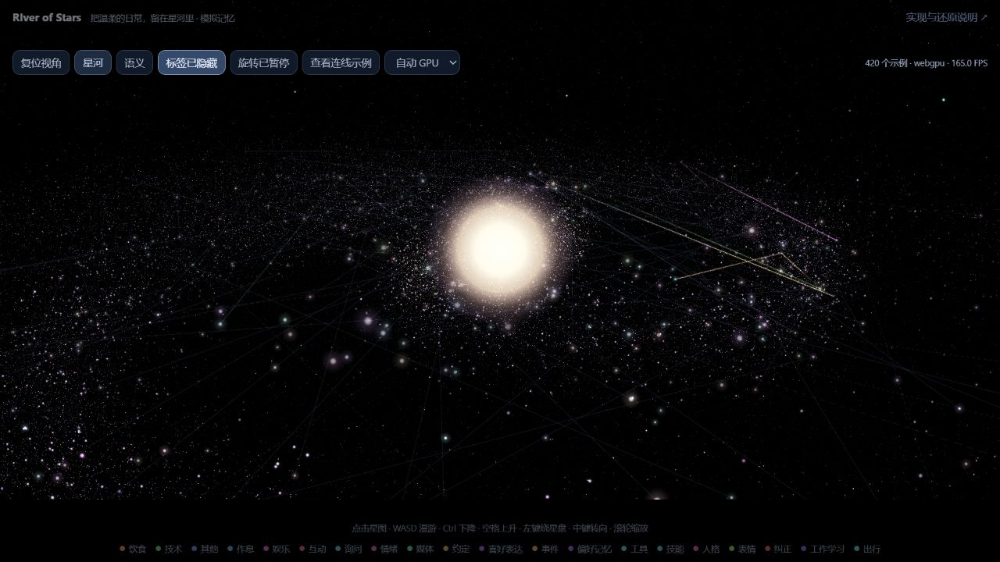
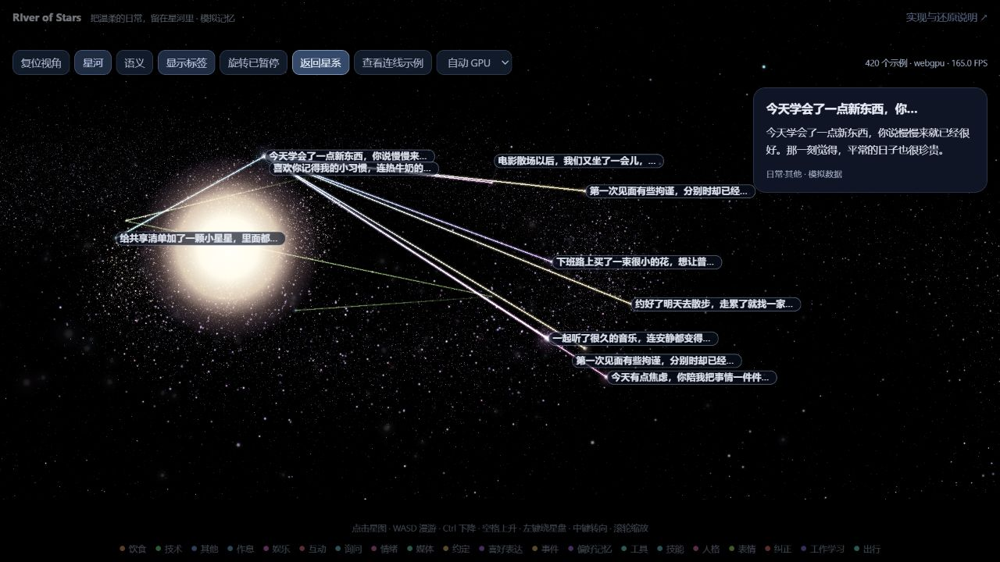
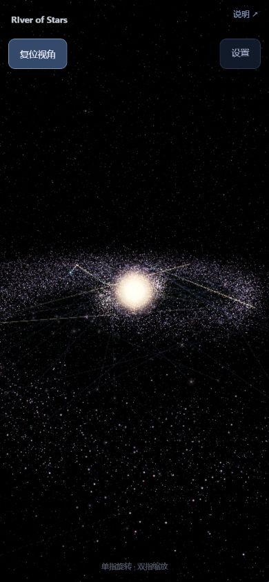

# RIver of Stars

把温柔的日常，留在星河里。

**[在线体验 ↗](https://czixue7.github.io/czixue7-RIver-of-Stars/)** · [实现与还原说明](记忆星图实现与样式还原说明.md)

一个可以自由漫游的交互记忆星图。暖白色的中心光球、蓝紫色的旋臂星尘，以及随记忆分类变化的连线，让零碎的日常成为可以重新走近的星星。

演示包含 420 条虚构记忆：一起煮的面、雨天偏过来的伞、忙碌时的一句“在的”。所有渲染代码、Three.js、GPU 模块和许可声明都已内嵌在 `index.html` 中。

## 效果预览

### 星系总览

暂停旋转、回到默认斜视角并隐藏标签，观察中心光球、旋臂和臂间星点的分布。



### 聚焦记忆与连线

开启标签并聚焦一条记忆，查看温暖的正文、相邻记忆和沿端点颜色渐变的连线。



### 手机界面

默认只显示“复位视角”和“设置”，底部保留一行手势提示。标签默认关闭，分类图例可从设置中开启，记忆详情显示在底部。



以上图片于 2026-11-11 从当前自包含网页实际截取，使用 WebGPU 渲染。截图为 README 展示素材，页面运行仅需要 `index.html`。

## 快速开始

下载仓库后，直接打开 `index.html` 即可使用兼容渲染模式。

要使用 WebGPU / WebGL 2，在文件所在目录启动本机静态服务器：

```sh
python -m http.server 8765 --bind 127.0.0.1
```

然后打开 [本地星图](http://127.0.0.1:8765/index.html)。工具栏会显示实际使用的渲染后端，也可以手动切换。

页面通过本地 HTTP 打开时，按 WebGPU → WebGL 2 → 兼容模式自动选择后端；通过 `file://` 打开时使用兼容模式。所有运行资源均在 HTML 内，无需额外安装前端依赖或配置 API。

## 操作方式

| 操作 | 效果 |
| --- | --- |
| 左键拖动 | 绕星盘旋转 |
| 中键拖动 | 摄像机转向 |
| 鼠标滚轮 | 以鼠标位置平滑缩放 |
| 手机单指拖动 | 绕星盘旋转 |
| 双指捏合 / 张开 | 以双指中心平滑缩小 / 放大，可同时平移 |
| 点击画布后按 WASD | 前后左右漫游 |
| Ctrl / 空格 | 摄像机下降 / 上升 |
| 点击记忆星点 | 查看正文及相邻关系 |
| 查看连线示例 | 直接进入预设的聚焦示例 |
| 显示标签 | 默认关闭；开启后优先显示近处记忆，最多 24 个并自动避让 |
| 复位视角 | 带速度曲线地回到默认斜视角 |

系统开启“减少动态效果”时，相应的入场、旋转和回归动画会简化或关闭。

手机窄屏和横屏会自动收起次要操作。点击“设置”可切换视图、标签、旋转、分类图例与渲染方式；点击星图区域可收起面板。画布始终铺满当前视口，横竖屏切换时同步调整绘制尺寸。

## 实现与修改

完整的实现分层、数据契约、亮度与尺寸参数、相机规则、加载时序及验收清单见：

[记忆星图实现与样式还原说明](记忆星图实现与样式还原说明.md)

- 修改示例记忆：在 `index.html` 末段脚本中搜索 `const samples` 和 `const echoes`。
- 修改页面外观：查看 HTML 头部的 `<style>`。
- 修改公共交互：搜索 `class MemoryCanvas`。
- 修改 GPU 渲染：解码 `<script type="importmap" id="river-modules">` 中对应模块的 data URL，修改后重新编码，并保留 `river/…` 导入关系。

星河排列是显示变换。接入真实数据时，应保留原始语义坐标和记录 ID；装饰星尘与真实记忆节点分别管理。标签开关、近处优先、平滑缩放和复位规则也应一起保留。

## 许可证与致谢

项目采用 [MIT License](LICENSE)。Three.js r187 与透视参考项目 `asdfd3/3d-memory-sea` 的完整许可和来源声明已保存在 HTML 顶部注释中，分发时请保留。

视觉方向参考 [拾光](https://ningning600.github.io/shiguang/)。本演示中的文字均为虚构示例。
